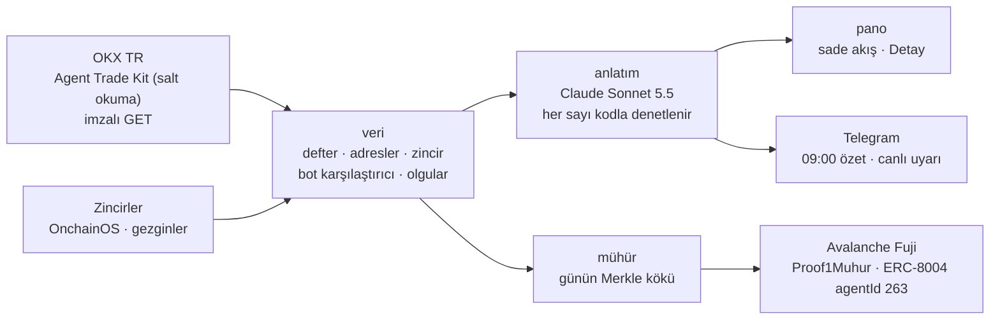

# proof1 · Paran nereye gitti?

<p align="center"></p>

**proof1, OKX TR'deki paranın nereye gittiğini zincirde kendisi izleyen, bot kayıtlarındaki hatayı yakalayan ve günün defterini Avalanche'a mühürleyen, yalnız okuyan bir yapay zekâ ajanıdır.**

**Canlı demo:** https://proof1-ivory.vercel.app · **Sunum:** [proof1 Sunum](https://claude.ai/artifact/TeBPJQvQkeeaoavxmh4xzn) · **Avalanche (Fuji C-Chain):** [`0x7C5aB869e8d972885673f19B848084279AAD0d48`](https://testnet.snowtrace.io/address/0x7C5aB869e8d972885673f19B848084279AAD0d48) · ERC-8004 agentId **263**

Agentic Hackathon Ankara · 17 Ekim 2026 · Buğra & Merve

---

## 30 saniyede

- **Problem.** OKX TR'ye TL yatırıyorsun; para spot alımlara, botlara, ücretlere ve cüzdanlara dağılıyor. "Param şimdi nerede, ne kadarını kaybettim?" sorusunun cevabı tek bir yerde yok.
- **proof1.** Borsa kaydını ve zinciri kendisi okur, defteri kapatır. Sonucu üç saniyede okunan tek bir akış şemasında gösterir. Her sabah Telegram'a yazar, bir bot durunca saniyeler içinde uyarır.
- **Gerçek olay.** Borsanın bot kaydı **+99,89 TL kâr** diyordu; hesaba dönen paraya göre sonuç **−0,22 TL** idi. proof1 farkı (100,11 TL) yakaladı ve nedenini kendisi araştırdı: elde kalan USDT iki kez sayılmış gibi.
- **Dene, kurulum yok.** [Siteye](https://proof1-ivory.vercel.app) gir, sağ üstten **Kendi hesabını bağla**'ya tıkla, OKX TR'de açtığın yalnız **Okuma** yetkili anahtarı yapıştır. İstekleri tarayıcın imzalar ve doğrudan OKX TR'ye gönderir. Anahtar hiçbir sunucuya gitmez.

## Jüri kriterleri → proof1

| Kriter | proof1'da nerede |
|---|---|
| **Ajan tasarımı · otonomi** | Sabah işi tek komutla baştan sona kendiliğinden çalışır: borsa → zincir → defter → bot karşılaştırması → olgular → cümleler → Telegram. Canlı izleyici bot durunca kimse sormadan uyarır. |
| **Ajan tasarımı · akıl yürütme ve araç seçimi** | Uyuşmazlık görünce anlatıcı hangi OKX aracını çağıracağına kendisi karar verir: plan → araç → gözlem → karar. Araştırma izi panoda (Detay → Bot) görünür; başarısız adım da gizlenmez. |
| **Teknik uygulama** | Çalışan, yayındaki ürün (Vercel + yerel tam sürüm). Dört ayrı modül, 330'dan fazla otomatik test, iki katmanlı salt okuma kilidi. Çok zincirli defter kapanışı, bot muhasebesi, Merkle mühür ve tarayıcıda imzalı OKX istemcisi var. |
| **Avalanche** | Fuji C-Chain'de kendi sözleşmemiz Proof1Muhur ve resmi ERC-8004 kaydı (agentId 263). Günün defter kökü saniyeler içinde kesinleşir; "dün ne yazıyordu" tartışması biter. |
| **OKX** | Borsa tarafında OKX Agent Trade Kit (salt okuma kipi), zincir tarafında OKX OnchainOS. Kurulumsuz web kipiyle OKX.AI'de servis olarak listelenmeye hazır. |
| **Yenilik ve değer** | Portföy uygulamaları bakiyeyi gösterir; proof1 borsanın kendi kaydını gerçek parayla denetler. Hedef: bot kullanan OKX TR kullanıcısı. Kullanıcı başına maliyet ayda yaklaşık 19 TL, fiyat OKX.AI'de ayda 0,99 $. |
| **Demo ve sunum** | Sahnede gerçek bot durdurulur, uyarı saniyeler içinde gelir. Arayüz sade: tek akış, en çok üç kart, ayrıntı "Detay"da. |

## Nasıl çalışıyor



- **Sayıları kod hesaplar, model değil.** Olgular (ör. `0,9828 AVAX`, `+99,89 TL`) koddan gelir. Model yalnız cümle kurar; cümledeki her sayı olgularla karşılaştırılır, tutmayan cümle gösterilmez, yerine kalıp cümle gider.
- **Bilmediğini uydurmaz.** Okuyamadığı ağı "okunamadı", tanımadığı girişi "tanıyamadım" diye yazar. Defterde kapanmayan kısım "açıklayamadım" olarak görünür.
- **Defter.** "Önceki bakiye + değişim = yeni bakiye" her para biriminde denetlenir. Bot sonucu, botun kendi kaydından değil, bota giren ve bot durunca hesaba dönen paradan hesaplanır.
- **Adresleri kullanıcı yazmaz.** proof1 adresleri çekim kaydından bulur. Hem çekim alan hem borsaya yatırma yapan adres "büyük olasılıkla senin" sayılır; kanıtıyla gösterilir, son karar kullanıcının.

## Salt okuma

proof1 yalnız okur: emir vermez, bot kurmaz ya da durdurmaz, para çekmez ya da taşımaz, öğüt vermez.

- **Birinci kilit:** ATK her zaman `--read-only` kipinde başlar; bir yazma aracı görünürse bağlantı reddedilir. İmzalı OKX TR uçları izinli listeyle çağrılır.
- **İkinci kilit:** anahtarın yetkisi (`account_get_config.perm`) okunur. İşlem ya da çekim yetkisi varsa hiçbir veri okunmadan durur.
- **Web kipi:** sayfa tarayıcı kuralıyla (CSP) yalnız `tr.okx.com`'a bağlanabilir. Dış betikler bütünlük karmasıyla (SRI) yüklenir, anahtar tarayıcıda hiçbir yere kaydedilmez.
- **Zincire yalnız kök gider;** adres ya da tutar gitmez. Gizli mod (öntanımlı açık) bakiye seviyelerini ve yüzdeleri gizler.
- **Model bütçesi** kullanıcı başına ayda 35 TL sert tavandır. Tavana yaklaşınca küçük model, tavanda kalıp cümle kullanılır.

## OKX araçları

- **Agent Trade Kit** (salt okuma): `account_get_bills`, `account_get_bills_archive`, `account_get_balance`, `account_get_config`, `spot_get_fills`, `grid_get_orders`, `grid_get_order_details`, `grid_get_sub_orders`, `market_get_candles`, `trade_get_history`. Sonuncusu ATK'nın kendi denetim kaydıdır; panoda kanıt olarak gösterilir.
- **OKX TR imzalı uçlar** (GET): `withdrawal-history`, `deposit-history`, `asset/bills`, `asset/balances`, `account/balance`. Web kipinde ayrıca `account/config` ve `asset-valuation`.
- **OnchainOS:** `transactions-by-address`, `all-token-balances-by-address`. BNB Chain, Base ve Optimism'de tek okuyucu, diğer ağlarda yedek. Kara liste işareti sahte token uyarısına yarar.

Panonun **Kanıt** sekmesi her çağrıyı süresi, kullandığı alanlar ve "salt okunur" etiketiyle listeler.

## Avalanche

| | Değer | Gezgin |
|---|---|---|
| Mühür sözleşmesi **Proof1Muhur** | `0x7C5aB869e8d972885673f19B848084279AAD0d48` | [adres](https://testnet.snowtrace.io/address/0x7C5aB869e8d972885673f19B848084279AAD0d48) · [dağıtım](https://testnet.snowtrace.io/tx/0x6382f45f82190887171fdfd230f49ea2088d63e857df4a59c2964ee995bb9a09) |
| ERC-8004 Identity Registry (resmi) | `0x8004A818BFB912233c491871b3d84c89A494BD9e` | [adres](https://testnet.snowtrace.io/address/0x8004A818BFB912233c491871b3d84c89A494BD9e) |
| proof1 kimliği | agentId **263** | [NFT](https://testnet.snowtrace.io/nft/0x8004A818BFB912233c491871b3d84c89A494BD9e/263) · [kayıt](https://testnet.snowtrace.io/tx/0x980921762cbd2b01335347c5fc1b52d8d8b7e06b1897d41e41e9987d4bbdc81e) |
| 16 Ekim'in gerçek defteri (16 satır) | kök `0x2f3a…8f22`, zincirde doğrulandı | [mühür işlemi](https://testnet.snowtrace.io/tx/0x5135feef5860b1689908ab2f56def30363fb22ca424ca8f0b109177e91b2ef34) |

Sözleşmeye yalnız NFT'nin sahibi yazabilir; her güne bir kez yazılır, üzerine yazılamaz, geriye tarih atılamaz. Ağ Fuji (chainId 43113); aynı resmi ERC-8004 sözleşmeleri ana ağda da kurulu, geçiş bir ayar.

**Mühür neyi kanıtlar?** Defterin o gün var olduğunu ve sonradan değişmediğini kanıtlar; doğruluğunu kanıtlamaz. Panodaki "Zincirde doğrula" zincirdeki kökü yerel kayıtla karşılaştırır.

## Hızlı başlangıç

**Kurulumsuz (web):** https://proof1-ivory.vercel.app → **Kendi hesabını bağla** → yalnız Okuma yetkili OKX TR anahtarı. Açılışta anonim örnek veri gösterilir. Kendi hesabında çekimler, yatırmalar, hesap değeri ve çekim günündeki dolar karşılığı gelir. Bot karşılaştırması, zincir taraması ve mühür tam sürümdedir.

### Kurulum (tam sürüm, kendi bilgisayarında)

```bash
git clone https://github.com/mryavascann/Proof1 && cd Proof1
python -m pip install -r veri/requirements.txt -r anlatim/requirements.txt -r muhur/requirements.txt   # Python 3.13
npm install -g @okx_ai/okx-trade-mcp                                                                  # OKX Agent Trade Kit
python -m pano.sunucu                                                                                 # http://localhost:3003
```

Veri yoksa pano örnek veriyle açılır; hesabını panodaki **Kendi hesabını bağla** ile eklersin. Anahtar bilgisayarından çıkmaz, diske yazılmaz. Sürekli kullanım (sabah işi, Telegram, mühür) için değerler `.env`'e yazılır (`.env.ornek`'e bak; depoya girmez).

### Çalıştırma

```bash
python -m calistir.sabah                        # sabah işi: borsa → zincir → defter → bot → olgu → anlatıcı → Telegram
python -m calistir.izle                         # canlı izleyici: bot durunca saniyeler içinde Telegram
python -m pano.sunucu                           # pano (telefondan göstermek için: --host 0.0.0.0)
python -m muhur.muhurle --gun 2026-10-17        # günün kökünü hesaplar (zincire yazmaz)
python -m muhur.muhurle --gun 2026-10-17 --gonder   # kökü Fuji'ye yazar (günde bir kez)
python -m pano.statik                           # web demosunu üretir (pano/_yayin/proof1 → Vercel)
CANLI=1 python -m unittest discover -s veri/testler -t .   # gerçek hesapla kabul testleri
```

`PROOF1_ARASTIR=canli` ise anlatıcı bot uyuşmazlığında ATK'yı kendisi okur ve araştırma izini yazar; `kayit` önceden alınmış gerçek yanıtları kullanır, ekranda "kayıt" etiketiyle.

## Demo sırası

```bash
python -m calistir.sabah                  # 1. rapor kendiliğinden gelir: Telegram + "Panoyu aç"
python -m pano.sunucu                     # 2. pano: tek akış, en çok üç kart; Detay → Bot'ta araştırma izi
python -m calistir.izle                   # 3. canlı an: bot insan tarafından durdurulur, uyarı saniyeler içinde gelir
python -m muhur.muhurle --gun 2026-10-17  # 4. günün kökü Avalanche'ta; gezginde ERC-8004 NFT ve mühür işlemi
```

Bot sahnede insan tarafından durdurulur; proof1 bot kurmaz, durdurmaz.

## Örnek veri ve canlı veri

| | Örnek veri | Canlı veri |
|---|---|---|
| Nerede | `ortak/ornek/proof1_ornek.db` (depoda) | `data/proof1.db` (yalnız yerel, depoya girmez) |
| Adresler | yer tutucu (`BENIM_1`, `ADRES_7`) | tam adres yalnız yerelde; ekranda kısaltılır (`0xABCD…1234`) |
| Bakiye | yok | var; gizli modda gösterilmez |
| Kullanım | web demosu, testler | sabah işi ve pano |

Önceden alınmış bir görüntü ya da kayıt ekranda her zaman **"kayıt"** etiketiyle gösterilir.

## Klasörler

| Klasör | İçerik |
|---|---|
| `veri/` | OKX TR ve ATK okuyucuları, zincir okuyucuları, defter, adres sahipliği, bot karşılaştırıcı, olgular |
| `anlatim/` | Anlatıcı (Claude Sonnet 5.5), sayı denetimi, araştırma izi, bütçe |
| `pano/` | Yerel sunucu, sade arayüz ve web kipi (`static/tarayici.js`), Vercel demosu |
| `muhur/` | Merkle kök, Avalanche Fuji mühür istemcisi, sözleşme |
| `calistir/` | Sabah işi, canlı izleyici, Telegram |
| `ortak/` | Örnek veri, görseller |

---

### In English

proof1 is a read-only AI agent for OKX TR users. It follows withdrawals on-chain and reconciles the ledger. It shows where the money went in one animated flow, and it catches trading-bot records that disagree with the money actually returned (+99.89 TL reported vs −0.22 TL real). Every day it seals the ledger's Merkle root on Avalanche Fuji (Proof1Muhur `0x7C5aB869e8d972885673f19B848084279AAD0d48`, ERC-8004 agentId 263). It uses OKX Agent Trade Kit in read-only mode and OKX OnchainOS. Try it without installing anything at https://proof1-ivory.vercel.app: your browser signs the requests and talks to OKX TR directly, so the key never reaches a server.
